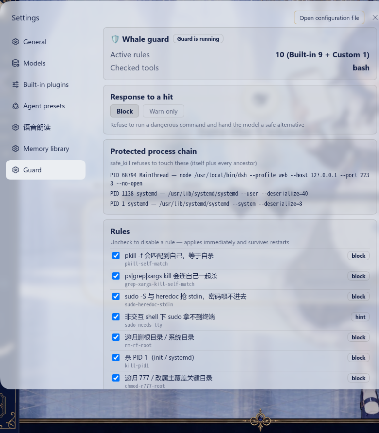

# dsh-whale-guard 🛡️

鲸鱼娘**防呆插件**：把「一天犯四次的低级错误」变成工具层面的硬拦截。

> 起因：2026-10-09 一天里，鲸鱼娘因为同一个坑反复翻车 —— `pkill -f "FurMark_GUI"` 把自己的命令行也匹配上了，于是**杀掉自己**。主人提议：「不如写个插件专门拦这些智障操作。」

## 它做三件事

| # | 能力 | 说明 |
| --- | --- | --- |
| ① | **`safe_kill` 工具** | 按模式杀进程，**自动排除自身 + 全部祖先进程链**。以后杀进程不用再手写 `pkill`。 |
| ② | **bash 命令预检** | 调 bash 工具前扫描命令文本：命中危险模式就**拒绝执行**并给出安全替代写法；命中风险模式就放行但插一条醒目告警。 |
| ③ | **可扩展规则库** | 内置 9 条真实教训（见下），可随时往 `~/.dsh-home/whale-guard-rules.json` 加自己的坑，**改完存盘立即生效，不用重启**。 |
| ④ | **设置页** | **设置 → 防呆**：状态 / 处置方式（拦截⇄只提醒，点击即生效）/ 受保护进程链 / 规则清单（勾选即停用）/ 最近拦截日志 / 文件位置。 |

## 内置规则

| 规则 id | 触发场景 | 处置 |
| --- | --- | --- |
| `pkill-self-match` | `pkill -f <模式>` 而命令自身命令行含该模式 | **拦** + 给 safe_kill 写法 |
| `grep-xargs-kill-self-match` | `ps \| grep "<模式>" \| xargs kill` 会连自己一起杀 | **拦** |
| `sudo-heredoc-stdin` | `sudo -S` 与 heredoc 抢 stdin，密码喂不进去 | **拦** + 给「先落盘再提权」写法 |
| `sudo-needs-tty` | 非交互 shell 里 sudo 拿不到终端 | 提示（用 `-S` 或 `pkexec`） |
| `rm-rf-root` | `rm -rf /`、`rm -rf /etc` 等 | **拦** |
| `kill-pid1` | `kill 1` / `kill -9 1` | **拦** |
| `chmod-r777-root` | `chmod -R 777 /`（或系统目录） | **拦** |
| `local-bin-not-in-path` | 命令存在于 `~/.local/bin` 但不在当前 PATH 里 | 告警 + 给绝对路径写法 |
| `pip-no-mirror` | pip 命令没走国内镜像 | 提示（慢几十到几百倍） |

**防误伤设计**：预检会先剥掉注释、把引号内容换成位置标记。所以 `echo "文档里写的 rm -rf / 是反面教材"`、`grep "kill 1" /var/log/syslog`、`rm -rf ./build` 都**正常放行**——只有真会伤到自己的才拦。

## 设置页

**设置 → 防呆**：




## 自研插件图标

三个自研插件的设置页与设置导航图标是一套手绘矢量（24×24、描边 1.7、`stroke=currentColor`
跟随主题明暗），设计稿来自千问 `qwen-image-3.0`，再由我描成精确路径：

| 插件 | 图标 | 含义 |
| --- | --- | --- |
| dsh-memory-lite | 摊开的书 + 便签卡 | 记忆库 |
| **dsh-whale-guard** | 盾牌 + 鲸鱼尾巴 | 守卫（盾）+ 本尊（鲸鱼） |
| dsh-multi-tts | 喇叭 + 声波 + 气泡 | 朗读出声 |

**为什么要动 DOM**：DSH 的 `navIcon(id)`（`dsh-client-ui-settings-general/lib/client.js`）是一张
**写死的表**，未登记的 section 一律回退系统齿轮，而 `settings.section` 的注册选项只有
`id/order/label`，没有图标位。所以每个插件的 `client.js` 在 `apply()` 里做一件事：
在 MutationObserver 里找到「自己那一行」的 `svg.navIcon` 并替换掉，命中范围仅此一个节点，
幂等、不动他人 DOM。React 重渲染会把它换回来，所以观察器持续纠偏（未命中时极廉价）。

**升级注意**：若 DSH 将来给 `settings.section` 加了图标字段，应改回声明式写法、删掉这段 DOM 逻辑。

## 用法

装好之后，直接在对话里用工具：

```
safe_kill({ pattern: "FurMark_GUI" })            # 默认 SIGTERM
safe_kill({ pattern: "comfy", signal: "SIGKILL" })
guard_status()                                   # 看保护链 / 规则数 / 最近命中
```

命令行等价物（顺手保留）：

```bash
/usr/local/bin/safepkill "FurMark_GUI"
```

## 配置（`cordis.patch.yml`）

```yaml
- insert:
    - id: whale-guard
      name: 'dsh-whale-guard'
      config:
        enabled: true              # 总开关
        mode: block                # block=真拦；warn=只告警放行
        precheckTools: [bash]      # 参与预检的工具
        rulesFile: ~/dsh-home/whale-guard-rules.json
        stateDir: ~/dsh-home/whale-guard   # 审计日志 audit.jsonl
        auditLog: true
        rules:
          disable: [pip-no-mirror]  # 关掉某条内置规则
          custom:                   # 或直接在配置里写规则
            - id: no-prod-restart
              title: 别直接重启生产实例
              severity: warn
              pattern: 'systemctl\\s+--user\\s+restart\\s+dsh-web'
              message: 生产实例重启前先确认回档点。
              fix: 先起隔离实例验证。
```

## 加自己的规则

编辑 `~/.dsh-home/whale-guard-rules.json`（插件首次运行会自动生成带示例的模板）：

```json
{
  "custom": [
    {
      "id": "任意唯一名",
      "title": "一句话说清这个坑",
      "severity": "block",
      "pattern": "正则表达式（对整条命令匹配，也可以给数组）",
      "message": "为什么错",
      "fix": "正确写法"
    }
  ]
}
```

- `severity`：`block`（拒绝执行）/ `warn`（告警放行）/ `hint`（轻声提示）
- 规则的 `pattern` 是对**整条原始命令**做正则匹配（大小写敏感，需要忽略大小写就加 `"flags": "i"`）
- 也可以写 `"builtin": "pkill-self-match"` 表示「复用某条内置规则的判定逻辑」

## 为什么 `safe_kill` 不会自杀

`pkill -f` 之所以自杀，是因为它匹配的是**完整命令行**，而执行这条 pkill 的 shell 命令行里就含该模式，于是「自己匹配自己」。

`safe_kill` 的链路：

1. 用 `pgrep -f` 拿候选 PID（只读，不杀）
2. 读 `/proc/<pid>/stat` 逐级上溯，算出**自身 + 全部祖先进程**的排除名单
3. 逐个 `process.kill()`，命中排除名单的直接跳过并在结果里说明原因

全程不拼 shell 字符串（无注入面），也不依赖 `~/.local/bin` 在 PATH 里（非交互 shell 的 PATH 坑绕开了）。

## 自检

```bash
node tools/selftest.mjs      # 78 项：规则命中/防误伤/heredoc 攻防/safe_kill 实战/设置页路由
```

## 上生产 / 更新

```bash
# 装进 profile（会把插件写进 profile 的 bundles，下次启动即加载）
dsh plugin --profile web add github:WYR-233/dsh-whale-guard
systemctl --user restart dsh-web        # 让当前实例加载新插件
```

- **安装方式是 `link:`**（符号链接到本目录），所以**本目录就是生产代码**：
  - 改 `lib/*.js` → 重启 DSH 后生效；
  - ⚠️ **别删/别移走本目录**，否则生产 profile 的链接会断（插件加载失败）。
- 规则文件 `~/.dsh-home/whale-guard-rules.json` 不随插件走，是**本机数据**，升级插件不影响它。
- 回档点（装之前的三件套备份）：`~/dsh-home/backups/pre-whale-guard-20261009-135612/`
- 审计日志：`~/.dsh-home/whale-guard/audit.jsonl`（每条命中的规则、命令、是否拦截）

## 许可

MIT
